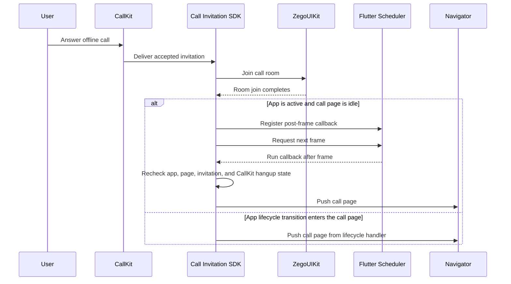
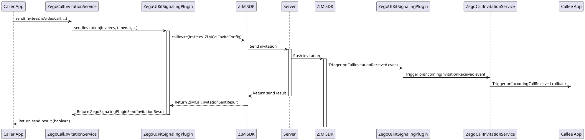
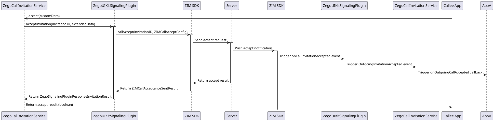
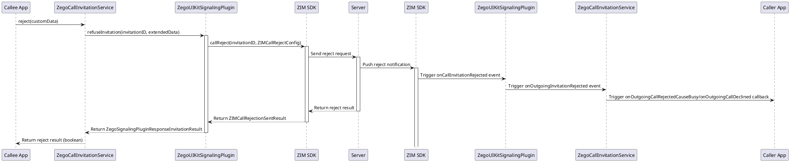
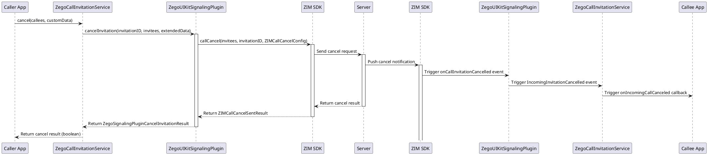
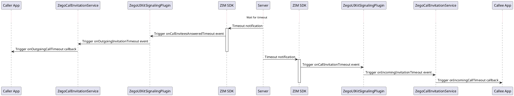

# ZEGO Call Invitation Sequence Diagrams

> 基准：2026-10-10

The following sequence diagrams illustrate the API call flows for various operations in the ZEGO Call Invitation system, implemented based on the ZIM SDK.

## iOS CallKit Answer and Call Page Entry

After an iOS CallKit answer, the SDK joins the room before presenting the call page. If the app is already active and the calling machine is still idle when room entry completes, the SDK schedules a frame callback and requests a frame. Before pushing the call page, the callback rechecks that the app is active, the page is idle, the accepted invitation is still current, and no CallKit hangup cleanup or pending page disposal blocks entry.

## Send Invitation

## Accept Invitation

## Reject Invitation

## Cancel Invitation

## Timeout Handling

These sequence diagrams illustrate the detailed flows of various operations in the ZEGO Call Invitation system, including the complete API call chain from the application layer to the ZIM SDK.
