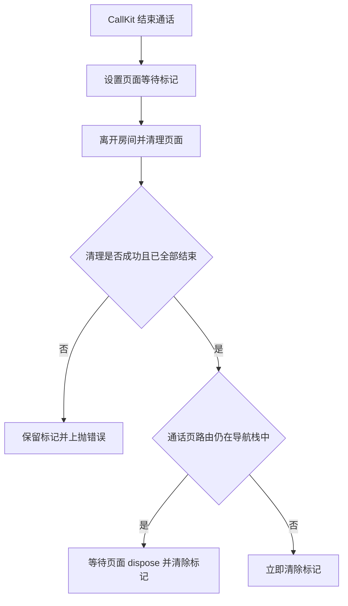
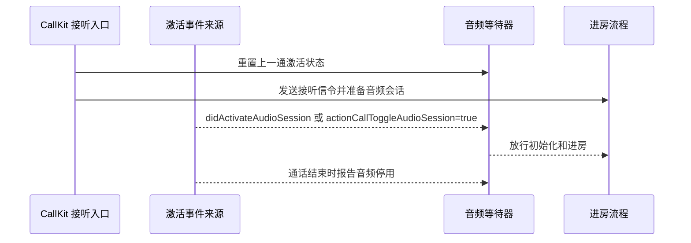

# CallKit 文件结构说明

基准：SDK 4.24.6 / 2026-10-13

## 概述

CallKit模块采用平台分离的架构设计，Android和iOS各自有独立的实现，但保持相同的文件结构和处理逻辑。

## 文件结构对比

### Android 结构

```
android/
├── defines.dart              # Android配置定义和消息处理类
├── entry_point.dart          # Android后台消息入口点
├── handler.dart              # 主消息处理器
├── handler.call.dart         # 呼叫邀请处理器
└── handler.im.dart           # IM消息处理器
```

### iOS 结构

```
ios/
├── defines.dart              # iOS配置定义和消息处理类
├── entry_point.dart          # iOS VoIP推送入口点
├── handler.dart              # 主消息处理器
├── handler.call.dart         # 呼叫邀请处理器
├── handler.im.dart           # IM消息处理器
```

## 核心文件说明

### 1. entry_point.dart

- **Android**: 处理后台静默通知，使用 `@pragma('vm:entry-point')` 标记
- **iOS**: 处理VoIP推送通知，实现 `onIncomingPushReceived` 回调

### 2. handler.dart

- **功能**: 主消息处理器，负责消息类型判断和分发
- **逻辑**:
  - 解析消息类型
  - 根据类型分发到IM处理器或呼叫处理器
  - 统一的错误处理和日志记录

### 3. handler.call.dart

- **功能**: 处理呼叫邀请相关消息
- **特性**:
  - 支持普通邀请和高级邀请模式
  - 处理邀请取消
  - 显示CallKit界面
  - 保持原有iOS离线呼叫逻辑

### 4. handler.im.dart

- **功能**: 处理IM消息
- **特性**:
  - 显示通知
  - 处理点击事件
  - 缓存会话信息
  - 打开应用并跳转

### 5. defines.dart

- **功能**: 定义消息处理相关的数据结构和配置
- **包含**:
  - HandlerPrivateInfo: 平台特定配置
  - BackgroundMessageHandlerMessage: 消息处理类
  - 消息类型枚举和扩展

## 消息处理流程

### Android 流程

1. 后台静默通知触发 `onBackgroundMessageReceived`
2. 检查应用是否运行，决定是否使用isolate
3. 解析消息类型
4. 分发到相应的处理器

### iOS 流程

1. VoIP推送触发 `onIncomingPushReceived`
2. 检查消息类型（IM消息 vs 呼叫邀请）
3. 分发到相应的处理器
4. 保持原有CallKit逻辑

## 消息类型支持

| 类型              | Android | iOS | 说明                                              |
| ----------------- | ------- | --- | ------------------------------------------------- |
| invitation        | ✅      | ✅  | 呼叫邀请                                          |
| text_message      | ✅      | ✅  | 文本消息 (Android: text_message, iOS: text_msg)   |
| media_message     | ✅      | ✅  | 媒体消息 (Android: media_message, iOS: media_msg) |
| cancel_invitation | ✅      | ✅  | 取消邀请                                          |

## 配置管理

### Android 配置

- `androidCallChannelID`: 呼叫通知渠道ID
- `androidMessageChannelID`: IM消息通知渠道ID
- `androidCallIcon/Sound/Vibrate`: 呼叫通知配置
- `androidMessageIcon/Sound/Vibrate`: IM消息通知配置

### iOS 配置

- `iosCallChannelID`: 呼叫通知渠道ID
- `iosMessageChannelID`: IM消息通知渠道ID
- `iosCallIcon/Sound/Vibrate`: 呼叫通知配置
- `iosMessageIcon/Sound/Vibrate`: IM消息通知配置

## 设计原则

1. **一致性**: Android和iOS保持相同的文件结构和处理逻辑
2. **分离性**: 平台特定代码完全分离，便于维护
3. **扩展性**: 易于添加新的消息类型和处理器
4. **兼容性**: 保持原有功能的完全兼容

## iOS CallKit 结束通话与页面等待标记

CallKit 结束通话时，SDK 先设置页面等待标记，挡住清理期间到来的下一通来电。同一时段内重叠的结束事件共用一次挂断清理；活动清理数用于防止其他并发清理提前解除保护。最后一个清理成功后，如果没有通话页路由就清除标记，否则等路由 dispose 后清除。iOS 离房返回非零错误码或清理步骤抛错都会保留标记并继续报告错误，下一次成功的挂断清理可以释放标记。锁屏通话状态只在 CallKit 信息清理成功后复位。清理未完成时，通话页 dispose 发出的清除请求不会生效。所有创建通话页的路由，包括最小化邀请恢复，都会在调用 Navigator push 前标记为待销毁，push 失败时回滚。判断依据是路由是否已发起或仍存在，不随应用前后台状态变化。



## iOS CallKit 音频激活与进房

iOS 来电有两条 CallKit 音频激活事件来源：VoIP 推送创建的来电由 signaling 插件提供 `didActivateAudioSession`；在线来电由 `flutter_callkit_incoming` 提供 `actionCallToggleAudioSession`。接听入口会先清空上一通激活状态，并指定本次等待器的预期事件来源；来自另一来源的激活和停用事件会被忽略。收到预期来源的激活事件后才放行进房，通话结束收到停用事件后清除激活状态。在线事件不包含通话 ID，因此同一来源的事件依赖 CallKit 按通话顺序送达。



## 消息结构差异

### Android 消息结构
```dart
extras: {
  'body': '消息内容',
  'title': '消息标题',
  'payload': '{"operation_type":"text_message",...}',
  'zego': {...}
}
```

### iOS 消息结构
```dart
extras: {
  'aps': {
    'alert': {
      'title': '消息标题',
      'body': '消息内容'
    }
  },
  'payload': '{"operation_type":"text_msg",...}',
  'zego': {...}
}
```

### 关键差异
1. **消息内容位置**: Android直接在extras中，iOS在extras['aps']['alert']中
